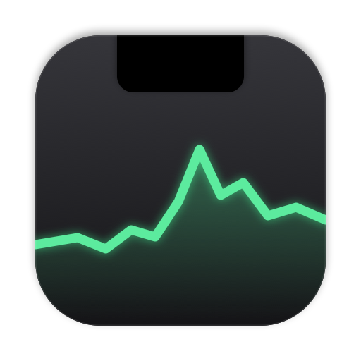
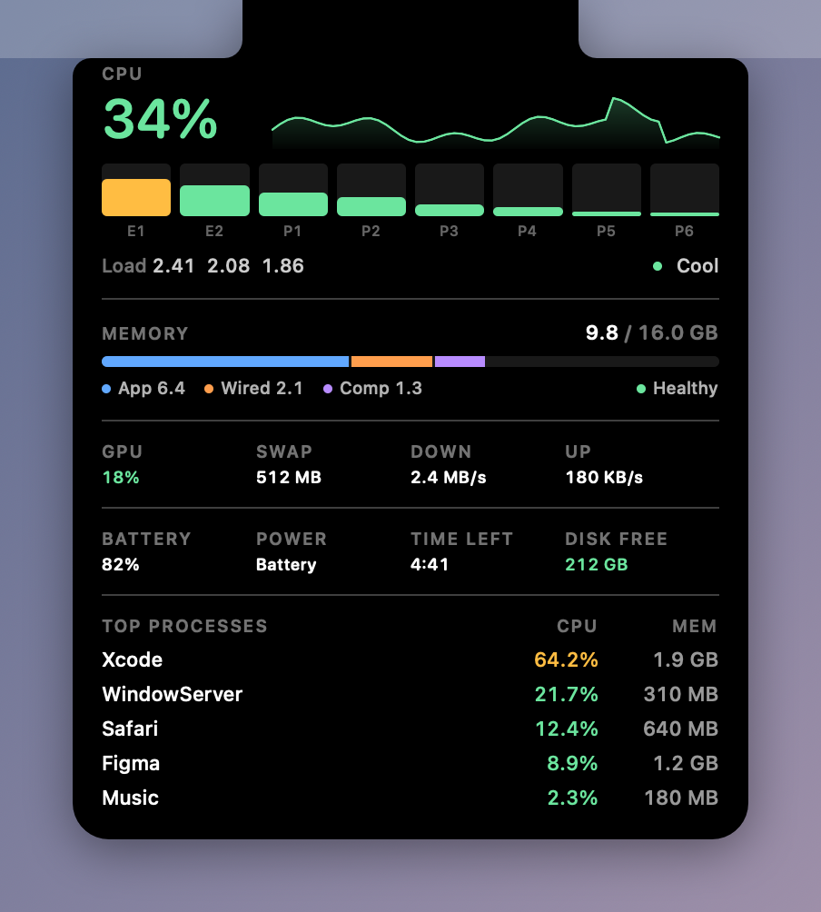

<p align="center">
  
</p>

<h1 align="center">Notchload</h1>

<p align="center">
  A system load monitor that lives under the MacBook notch.<br>
  A glance shows CPU and memory. Hover for everything else, click to keep it open.
</p>

<p align="center">
  <a href="https://github.com/BRIJRAJ-02/notchload/actions/workflows/ci.yml"></a>
  
  
  
</p>

<p align="center">
  
</p>

## What it does

- **Extends the notch.** A black tab hangs directly below it, 24 points tall and exactly as wide, showing CPU, a 30-second trace and memory.
- **Opens on hover.** The tab grows into a panel with the full picture, and closes when you move away.
- **Pins open.** Click it and the panel stays put while you work. Click again or press Escape to let it go.
- **Names the culprit.** When CPU has been at 85% or more for 30 seconds, the tab swaps its trace for the name of the process responsible, and swaps back once load falls.
- **Shows every core.** One bar each, labelled as efficiency or performance cores.
- **Breaks memory down** the way Activity Monitor does: app, wired and compressed, plus memory pressure and swap.
- **Covers the rest.** GPU utilisation, network up and down, load averages, thermal state and the five busiest processes.
- **Shows battery and disk.** Charge, whether it is charging, time left or time to full, and free space on the startup disk. A Mac without a battery shows the disk alone.
- **Acts on a process.** Right-click one of the five to quit or force quit it.
- **Stays light.** No Dock icon, no menu bar item, about 0.3% CPU. The process list is only sampled while the panel is open or load has stayed high.

<p align="center">
  
</p>

<p align="center">
  
</p>

## Install

### Download

Get `Notchload-x.y.z.dmg` from the [latest release](https://github.com/BRIJRAJ-02/notchload/releases/latest), open it and drag Notchload to Applications. It runs on Apple Silicon and Intel, macOS 14 or later.

The app is not notarized, so macOS blocks the first launch. Either allow it under System Settings → Privacy & Security → Open Anyway, or run:

```bash
xattr -dr com.apple.quarantine /Applications/Notchload.app
```

### Build from source

Requires Xcode 16 or later (for the Swift toolchain).

```bash
git clone https://github.com/BRIJRAJ-02/notchload.git
cd notchload
./scripts/build-app.sh --install   # builds, copies Notchload.app to /Applications, launches it
```

## Using it

| Do this | To |
|---|---|
| Glance at the tab | Read CPU and memory |
| Hover the tab | Open the panel |
| Move away | Close it |
| Click the tab or panel | Pin the panel open. A small pin appears in its corner |
| Click again | Unpin. It closes when you move away |
| Press Escape with the pointer over a pinned panel | Unpin and close it |
| Right-click a process | Quit or Force Quit it, Open Activity Monitor |
| Right-click anywhere else on the tab or panel | Launch at Login, Open Activity Monitor, Quit Notchload |

Numbers are green below 60%, amber from 60% and red from 85%. Memory is coloured by system memory pressure, not by how full it is, because a full Mac is often a healthy one.

Under sustained load the tab names a process only if one stands out: it has to be using at least half a core. The name holds until CPU has been below 70% for five seconds, so a brief dip does not flip the tab back and forth.

Quit asks an app to close the way Cmd-Q does, so it can still prompt about unsaved work. Force Quit asks you first, then ends the process on the spot. Neither is offered for Notchload itself or for `kernel_task`, `launchd`, `WindowServer` and `loginwindow`, and processes that belong to the system or another user will refuse.

A pinned panel takes the keyboard only while the pointer is over it, which is how Escape reaches it. Type anything else and it hands the keyboard straight back.

On a display without a notch (an external monitor, or the lid closed) the tab hangs from the bottom of the menu bar instead.

## Design notes

- **The notch is the anchor.** The tab is pure black and the same width as the notch, so it reads as the hardware growing a little, not as a window.
- **One shape, two sizes.** The tab and the panel are the same path. Its shoulders flare out below the menu bar as it opens, so it never covers menu bar items.
- **Color means something.** Green, amber and red are only ever load levels.
- **Numbers that hold still.** Every figure uses tabular digits, so values do not jitter as they update.
- **Deliberate hover.** The panel waits a beat before opening, so passing over the tab on the way to a browser tab does not trigger it, and waits a little longer before closing.
- **Click-through.** The window is transparent to the mouse everywhere outside the visible shape.
- **Blame carefully.** The tab only names a process after load has been high for a while, and never changes its mind on a single sample.
- **Respectful motion.** One spring, and a plain fade with Reduce Motion.

## How it is built

```
Sources/
  NotchloadCore/   UI-free sampler: CPU, memory, GPU, network, processes, battery, disk,
                   plus the sustained-load rule, the quit guard and formatting
  Notchload/       the panel: window placement, hover and pin tracking, menus, SwiftUI views
Tests/             parsing, formatting, the sustained-load rule, the quit guard,
                   and live sanity checks of the sampler
scripts/           build-app.sh bundles the app and the DMG; make-icon.swift draws the icon in code
```

Where the numbers come from:

| Reading | Source |
|---|---|
| CPU, per core | `host_processor_info` tick deltas |
| Memory | `host_statistics64`, `kern.memorystatus_vm_pressure_level`, `vm.swapusage` |
| GPU | `IOAccelerator` performance statistics |
| Network | `getifaddrs` byte counters on `en*` interfaces |
| Processes | `ps`, every two seconds while the panel is open, every five while load is sustained and it is closed |
| Battery | IOKit power sources, every ten seconds while the panel is open |
| Disk | Volume capacity of `/`, counting space macOS can reclaim, on the same schedule |

Nothing needs special permissions, and nothing leaves your Mac.

### Developing

```bash
swift build && swift test       # or open Package.swift in Xcode
./scripts/build-app.sh --open   # build and launch the app bundle
./scripts/build-app.sh --dmg    # universal build, packaged as build/Notchload-<version>.dmg
.build/debug/Notchload --snapshot docs   # re-render the README screenshots with sample data
.build/debug/Notchload --snapshot /tmp/shots --extras   # also render the pinned, charging, low battery and no battery states
```

## License

[MIT](LICENSE)
